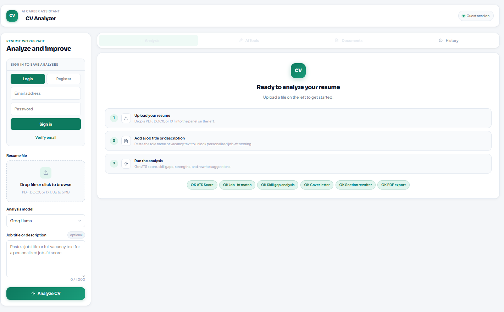
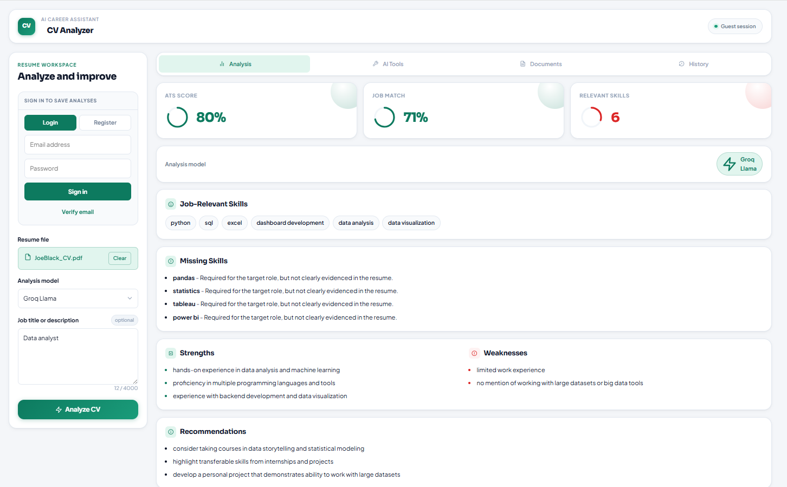
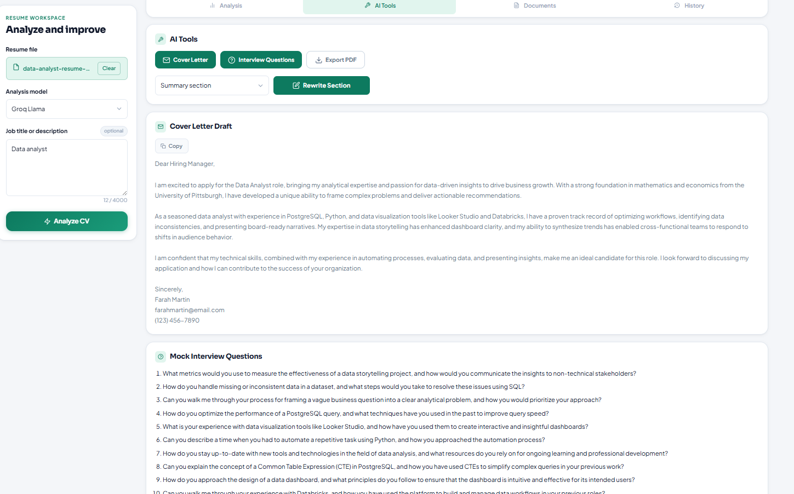
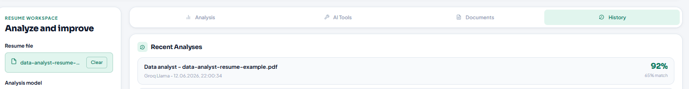
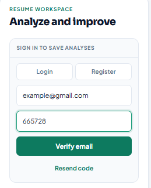

# CV Analyzer AI SaaS

AI-assisted resume analysis platform for ATS scoring, job-fit feedback, skill gap detection, and AI-generated career documents.

Live app: https://cvanalyzerai.com

## Features

- Resume upload: PDF, DOCX, TXT
- Auth: register, login, JWT session
- Analysis modes:
  - OpenAI GPT
  - Groq Llama
  - local NLP with pretrained sentence-transformers
- ATS-style score
- Job match score
- Job-relevant skills
- Missing skills
- Strengths, weaknesses, recommendations
- Improved resume summary
- Cover letter generation
- Mock interview questions
- Resume section rewrite
- PDF report export
- Per-user analysis history
- PostgreSQL persistence
- Optional Sentry error monitoring
- Optional Google Analytics tracking
- Docker Compose full-stack setup

## Screenshots

### Resume Workspace



### Analysis Results



### AI Tools



### Analysis History



### Email Verification



## Tech Stack

- Frontend: Next.js, React, TypeScript
- Backend: FastAPI, Python 3.12
- Database: PostgreSQL, SQLAlchemy, Alembic
- Auth: JWT, passlib/bcrypt
- AI providers: OpenAI API, Groq OpenAI-compatible API
- Optional local NLP: sentence-transformers
- File parsing: PyMuPDF, python-docx
- PDF export: ReportLab
- Deployment: Docker Compose, VPS/Render/Railway-ready structure

## Project Structure

```text
backend/
  app/
    routes/
    services/
    models/
  alembic/
  Dockerfile
frontend/
  app/
  Dockerfile
docker-compose.yml
```

## Environment

Create `backend/.env` for local backend development:

```env
DATABASE_URL=sqlite:///./cv_analyzer.db
ENV=development
FRONTEND_ORIGIN=http://localhost:3000
FRONTEND_ORIGINS=["http://localhost:3000"]
OPENAI_API_KEY=
OPENAI_MODEL=gpt-4o-mini
GROQ_API_KEY=
GROQ_MODEL=llama-3.3-70b-versatile
LLM_PROVIDER=openai
JWT_SECRET_KEY=replace-with-a-long-random-secret
JWT_ALGORITHM=HS256
ACCESS_TOKEN_EXPIRE_MINUTES=1440
MAX_UPLOAD_BYTES=5242880
MAX_PDF_PAGES=30
ENABLE_LOCAL_NLP=false
NEXT_PUBLIC_ENABLE_LOCAL_NLP=false
SENTRY_DSN=
SENTRY_TRACES_SAMPLE_RATE=0.05
NEXT_PUBLIC_GA_MEASUREMENT_ID=
```

Never commit `.env` or real API keys.

## Local Development

### Backend

```powershell
cd backend
..\.venv\Scripts\activate
uvicorn app.main:app --reload --port 8000
```

If your virtual environment is in the project root, the correct command from `backend/` is:

```powershell
..\.venv\Scripts\activate
```

Backend:

```text
http://localhost:8000
```

Swagger:

```text
http://localhost:8000/docs
```

### Frontend

```powershell
cd frontend
npm install
npm run dev
```

Frontend:

```text
http://localhost:3000
```

## Docker Full Stack

Start Docker Desktop first.

For local Docker without AI keys:

```powershell
$env:JWT_SECRET_KEY="local-dev-secret-at-least-32-chars"
$env:POSTGRES_PASSWORD="local-postgres-password"
docker compose up --build
```

With Groq:

```powershell
$env:GROQ_API_KEY="your_groq_key"
$env:LLM_PROVIDER="groq"
$env:JWT_SECRET_KEY="local-dev-secret-at-least-32-chars"
$env:POSTGRES_PASSWORD="local-postgres-password"
docker compose up --build
```

With OpenAI:

```powershell
$env:OPENAI_API_KEY="your_openai_key"
$env:LLM_PROVIDER="openai"
$env:JWT_SECRET_KEY="local-dev-secret-at-least-32-chars"
$env:POSTGRES_PASSWORD="local-postgres-password"
docker compose up --build
```

Services:

```text
Frontend: http://localhost:3000
Backend:  http://localhost:8000
```

PostgreSQL is available only inside the Docker network. To inspect it:

```powershell
docker compose exec db psql -U cv_user -d cv_analyzer
```

Stop:

```powershell
docker compose down
```

Stop and remove database volume:

```powershell
docker compose down -v
```

## Database

Docker uses PostgreSQL:

```text
postgresql://cv_user:<POSTGRES_PASSWORD>@db:5432/cv_analyzer
```

Local non-Docker development can use SQLite or local PostgreSQL.

Run migrations manually from `backend/`:

```powershell
alembic upgrade head
```

The backend Docker container runs migrations automatically before starting the API.

## Optional Job-Skill Dataset Enrichment

## Optional Local NLP

The default Docker image is production-lite and does not install PyTorch or sentence-transformers. This keeps small hosts such as Railway trial/Hobby cheaper and more stable.

For local experiments with semantic scoring, install optional NLP dependencies:

```powershell
cd backend
..\.venv\Scripts\activate
pip install -r requirements-nlp.txt
```

Then enable the local NLP mode:

```env
ENABLE_LOCAL_NLP=true
NEXT_PUBLIC_ENABLE_LOCAL_NLP=true
```

For Docker/Railway deployments, also enable optional dependency installation during the backend image build:

```env
INSTALL_LOCAL_NLP=true
```

Leave these disabled on small production hosts.

## Optional Job-Skill Dataset Enrichment

The local NLP/rules analyzer can use an offline role-to-skills profile generated from a HuggingFace parquet dataset.

Install optional data dependencies:

```powershell
cd backend
..\.venv\Scripts\activate
pip install -r requirements-data.txt
```

Build generated profiles:

```powershell
python scripts\build_job_skill_profiles.py
```

This reads:

```python
pd.read_parquet("hf://datasets/batuhanmtl/job-skill-set/data/train-00000-of-00001.parquet")
```

and writes:

```text
backend/app/data/job_skill_profiles.generated.json
```

That generated file is ignored by Git because it can become large. If it exists locally, backend automatically uses it to improve role-based required skill detection.

## API Endpoints

- `GET /health`
- `POST /api/auth/register`
- `POST /api/auth/login`
- `GET /api/auth/me`
- `POST /api/analyze`
- `GET /api/analyses`
- `POST /api/generate/cover-letter`
- `POST /api/generate/interview-questions`
- `POST /api/generate/rewrite-section`
- `POST /api/export/report`

## Roadmap

- Stronger LLM post-processing and structured skill evidence
- Required skills count in API response
- RAG knowledge base for HR/resume best practices
- Multi-language resume analysis
- Admin analytics dashboard
- Production deployment
